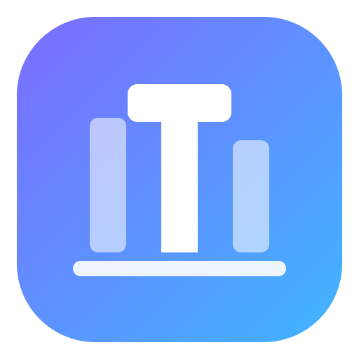
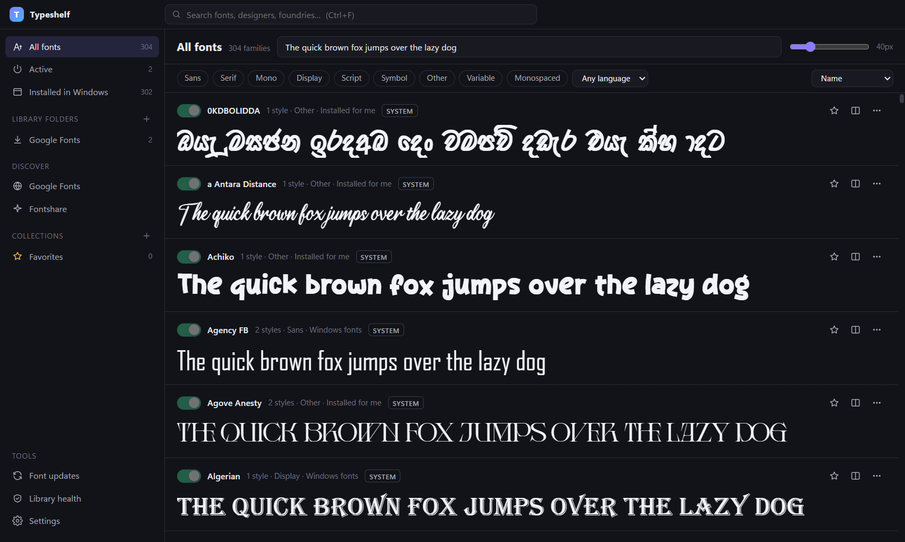

<p align="center">
  
</p>

<h1 align="center">Typeshelf</h1>

<p align="center">
  A free, open-source font manager for Windows.<br>
  Activate fonts without admin rights, browse Google Fonts and Fontshare, and keep downloaded fonts up to date automatically.
</p>

<p align="center">
  <a href="../../releases/latest"><b>Download for Windows</b></a> ·
  <a href="https://cenodigital.com/typeshelf/">Website</a> ·
  <a href="CONTRIBUTING.md">Contributing</a>
</p>

<p align="center">
  
</p>

## Why Typeshelf

- **Fonts on and off in one click.** Activate fonts for your Windows account without admin rights or copying files into `C:\Windows\Fonts`. Choose *permanent* (survives restarts) or *session* (removed when you quit).
- **Fonts that update themselves.** Families installed from Google Fonts and Fontshare are checked for new versions in the background. Each update is validated before it replaces anything, the previous version is kept for one-click rollback, and active fonts are switched straight back on. Pause updates for any family.
- **Live reload while you design.** Drop a new version of a font you're working on into a watched folder and apps see it straight away.
- **Find the right font fast.** Search and filter by category, variable fonts, monospace and language support, including Sinhala, Tamil, Devanagari, Arabic, Cyrillic, Greek, Thai and CJK.

## Features

| Area | What you get |
| --- | --- |
| **Library** | Indexes Windows fonts, your installed fonts and any folders you add (TTF, OTF, TTC, OTC, WOFF, WOFF2). About 800 files index in 2 seconds on first run and almost instantly after that. |
| **Activation** | Per-user activation with no admin rights, permanent or for this session only. On startup the app re-checks Windows' font list, restores entries Windows removed and cleans up leftovers. |
| **Auto-updating fonts** | Background update checks for Google Fonts and Fontshare families, including straight after launch if your PC was off. Validated downloads, safe swap-in, automatic rollback on failure and one-click manual rollback. |
| **Discover** | The full Google Fonts and Fontshare catalogues with live previews. Install variable or static styles in one click. The catalogue is cached for offline use. |
| **Type tester** | Your own text, variable-axis sliders, OpenType feature toggles, tracking, line height, waterfall view and copy-as-CSS. |
| **Glyphs** | Browse every glyph; search by name, character or `U+` code; copy the character, HTML entity or CSS escape. |
| **Organise** | Favourites, colour-coded collections, turning a whole collection on or off, and side-by-side comparison of up to 6 families. |
| **Library health** | Duplicate and conflicting fonts, unreadable files and disk usage. |
| **Developers** | `@font-face` CSS generator and font file export. |
| **App** | Tray icon, launch at login, light and dark themes, notifications and automatic app updates. |

## Install

Download `Typeshelf-Setup-<version>.exe` from the [latest release](../../releases/latest) and run it. It installs for your Windows account only, so you don't need admin rights.

Requires Windows 10 or 11 (64-bit).

> Until the installer is code-signed, Windows SmartScreen may show "Windows protected your PC". Click **More info**, then **Run anyway**.

## Privacy

Typeshelf has no account, no ads and no tracking. It only connects to the internet to:

- load the Google Fonts and Fontshare catalogues and font previews, and download fonts you choose to install;
- check those fonts for updates;
- check for new versions of Typeshelf itself.

Links in the app (newsletter sign-up, bug reports, cenodigital.com) only open in your browser when you click them. Links to cenodigital.com include `utm_*` tags so we can see that a visit came from Typeshelf; nothing else is attached. Bug reports open a GitHub form with your Typeshelf and Windows versions filled in, and you decide what to submit.

Your library index, settings and collections stay on your PC in `%APPDATA%\Typeshelf`. When you uninstall, the uninstaller asks whether to turn off the fonts Typeshelf activated.

## Development

You need Windows 10 or 11 and Node.js 24.

For Google Fonts, official builds use the [Google Fonts Developer API](https://developers.google.com/fonts/docs/developer_api). To use it locally, copy `.env.example` to `.env.local` and add a key. Without a key the app falls back to fonts.google.com's public endpoints, which work but are undocumented.

```bash
npm ci
npm run dev        # the app, with hot reload
npm run dev:web    # the UI only, in a browser, with sample data (http://localhost:5199)
npm run typecheck
npm test           # unit tests and tests against your installed fonts
LIVE=1 npm test    # also downloads from Google Fonts and Fontshare
npm run test:e2e   # drives the real app with Playwright (see docs/TESTING.md)
node scripts/activation-e2e.mts   # real activate → verify → deactivate on this PC
```

### Building the installer

```bash
npm run dist       # dist/Typeshelf-Setup-<version>.exe (per-user NSIS installer)
npm run dist:dir   # unpacked app in dist/win-unpacked
npm run notices    # regenerate THIRD_PARTY_NOTICES.md after changing dependencies
```

Electron is pinned to 44.10.2. Microsoft Defender flagged the `ffmpeg.dll` shipped with Electron 45.2.3 on our build machine as a false positive, so scan the new binaries before upgrading (`Start-MpScan -ScanType CustomScan -ScanPath node_modules\electron\dist`).

### Architecture

```
src/
  shared/      types and pure family logic (used by the UI and tests)
  main/        Electron main process
    scanner/     font parsing with fontkit in worker threads
    activation/  Win32 calls through koffi, and the activation manager
    providers/   Google Fonts and Fontshare catalogues, downloads and caching
    library.ts       sources, scan cache, folder watching, hot-reload
    fontUpdates.ts   install, update, rollback and the update scheduler
    fontProtocol.ts  tsfont:// serves only indexed files and splits font collections
    ipc.ts           validated IPC surface
  preload/     contextBridge API
  renderer/    React 19, zustand and @tanstack/react-virtual
```

**Security:**
- **Window:** the window is sandboxed with context isolation and no Node integration, and runs under a strict Content Security Policy. Navigation and new windows are blocked.
- **IPC:** every argument coming from the window is validated.
- **Font files:** the font protocol only serves files that are in the index, zip extraction ignores folder paths in archives, and downloads only come from known provider hosts.
- **Packaged app:** Electron's Node mode, inspector flags and `NODE_OPTIONS` are switched off. The app only loads from its own archive, and that archive is integrity-checked at startup.

## Releases

See [docs/RELEASING.md](docs/RELEASING.md) for how releases, self-updates and code signing work, and [CHANGELOG.md](CHANGELOG.md) for what changed.

## Contributing

Bug reports, fixes and translations are welcome. See [CONTRIBUTING.md](CONTRIBUTING.md). To report a security problem, see [SECURITY.md](SECURITY.md).

## Licence

Typeshelf is free software, licensed under the [GNU General Public License v3.0 or later](LICENSE). Third-party components and their licences are listed in [THIRD_PARTY_NOTICES.md](THIRD_PARTY_NOTICES.md).

Typeshelf doesn't include or sell any fonts. Fonts you download come from Google Fonts or Fontshare under their own licences, shown on each family's Info tab.

"Typeshelf" and its icon identify the official builds from CenoDigital. If you publish a modified version, please give it a different name.

---

<p align="center">Made by <a href="https://cenodigital.com">CenoDigital</a></p>
